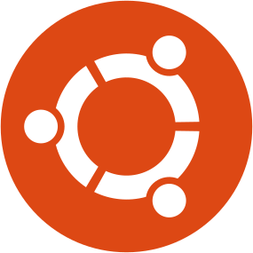

# Setting Up macOS or Ubuntu for Development

<table>
  <tr>
    <td valign="top" style="width:64px;padding-right:16px">
      
      
    </td>
    <td valign="top">
      <p>
        Configurations and scripts to set up a development environment on macOS or Ubuntu.
        macOS uses bootstrap-macos.sh and Ubuntu uses bootstrap-ubuntu.sh, though both share common configurations and tools.
      </p>
      <p>
        The Ubuntu setup mirrors the macOS environment so both systems behave similarly.
        Some tools and configurations work on other platforms, but this repository is built around macOS on Apple Silicon and Ubuntu.
        The dotfiles use zsh, so you should run zsh on both macOS and Ubuntu.
        The setup scripts are written in bash and run with <code>bash</code> on both platforms.
      </p>
      <p>
        I mostly work with JavaScript, Java, and occasionally Python, and this setup reflects that.
        These are my personal dotfiles, but feel free to adapt them for your own use.
      </p>
      <p>
        I tested this on macOS Golden Gate 27.0.1 with Apple Silicon and Ubuntu 26.04 on WSL, but it should work on other versions as well.
      </p>
    </td>
  </tr>
</table>

## Table of Contents

- [Setting Up macOS or Ubuntu for Development](#setting-up-macos-or-ubuntu-for-development)
  - [Table of Contents](#table-of-contents)
  - [Prerequisites](#prerequisites)
  - [This Setup Includes](#this-setup-includes)
  - [Installation](#installation)
    - [Backup Previous Settings (Optional - If Migrating - macOS Only)](#backup-previous-settings-optional---if-migrating---macos-only)
    - [Install on New Machine macOS](#install-on-new-machine-macos)
    - [Install on New Machine Ubuntu](#install-on-new-machine-ubuntu)
    - [Install on New Machine Windows WSL](#install-on-new-machine-windows-wsl)
      - [Disable Windows Path Integration in WSL](#disable-windows-path-integration-in-wsl)
      - [Run the Ubuntu Setup](#run-the-ubuntu-setup)
  - [Post-Installation Setup](#post-installation-setup)
    - [Configure Git Profiles](#configure-git-profiles)
    - [Set Up Utility Scripts (Optional)](#set-up-utility-scripts-optional)
    - [On the New Machine (Optional - If Migrating - macOS Only)](#on-the-new-machine-optional---if-migrating---macos-only)
  - [Themes](#themes)
  - [Roadmap](#roadmap)
  - [Contributing](#contributing)
  - [Credits](#credits)
  - [License](#license)

## Prerequisites

- macOS Tahoe with Apple Silicon (M1, M2, M3, M4, M5...)
- Ubuntu
- Git installed
- Command Line Tools for Xcode installed
- Basic terminal familiarity
- Optional: iCloud Drive enabled (for backup and restore steps)

## This Setup Includes

- **Rosetta 2**: Enables Intel macOS applications on Apple Silicon (macOS only)
- **Homebrew**: Package manager with essential development tools (macOS only)
- **APT packages**: Shell tools and development utilities for Ubuntu
- **GNU Stow**: Symlink manager used to install all dotfiles into `$HOME`
- **Zsh Configuration**: Terminal setup with Oh My Zsh, Powerlevel10k, and custom aliases, functions, and plugins
- **Vim & Neovim**: Editors configured with the Nord theme
- **iTerm2 Configuration**: Color scheme and font setup (macOS only)
- **Git Setup**: Separate configurations for personal and work profiles
- **Finder Quick Action**: Open folders/files in VS Code from Finder (macOS only)
- **macOS Optimization**: System settings tuned for development
- **Utility Scripts**: Backup, transcription, and other helper scripts added to `~/scripts`

## Installation

> **Warning:** Back up your existing dotfiles (`~/.zshrc`, `~/.zshenv`, `~/.p10k.zsh`, etc.) before running the bootstrap scripts, then remove them from `$HOME`.
> The dotfiles are installed with `stow --adopt`, which moves any existing file with the same name into `~/.dotfiles`, replacing the version from this repository. If you skip this step, you keep your old configuration instead of this one.

### Backup Previous Settings (Optional - If Migrating - macOS Only)

If you are migrating from another Mac, back up your settings first.
In this example, copy your Zsh history and SSH keys to iCloud Drive so you can restore them on the new machine after setting up the dotfiles.
Keep your SSH keys private and delete them from iCloud Drive after restoring them on the new machine.
If your keys are particularly sensitive, use a more secure transfer method instead, such as an encrypted external drive.

```bash
mkdir -p ~/Library/Mobile\ Documents/com~apple~CloudDocs/Software
mkdir -p ~/Library/Mobile\ Documents/com~apple~CloudDocs/Software/.ssh
cp ~/.zsh_history ~/Library/Mobile\ Documents/com~apple~CloudDocs/Software/.zsh_history
cp ~/.ssh/* ~/Library/Mobile\ Documents/com~apple~CloudDocs/Software/.ssh
```

### Install on New Machine macOS

Clone this repository and run the bootstrap script for macOS:

```bash
git clone https://github.com/gonafr/dotfiles.git
cd dotfiles
bash bootstrap-macos.sh
```

The `bootstrap-macos.sh` script runs `bootstrap-finder.sh`, which installs an Automator workflow allowing you to open files and folders in VS Code from Finder (right-click > **Quick Actions** > **Open in VS Code**). The workflow files are installed to `~/Library/Services`, and the installer removes the temporary files in the repository's `finder/` folder once complete.

> **Note:** During the bootstrap, `bootstrap-iterm.sh` copies the iTerm2 color schemes to `~/iterm/`. You still need to complete two manual steps: import the `.itermcolors` file via `iTerm2 > Settings > Profiles > Colors > Color Presets... > Import...`, and set the font to **Hack Nerd Font** (size 14) under `Profiles > Text`. The script prints these instructions when it runs.

### Install on New Machine Ubuntu

Clone this repository and run the bootstrap script for Ubuntu:

```bash
git clone https://github.com/gonafr/dotfiles.git
cd dotfiles
bash bootstrap-ubuntu.sh
```

> **Note:** If zsh is not your default shell, the script changes it and asks you to log out and back in. After logging back in, run the script again to finish the setup.

### Install on New Machine Windows WSL

On Windows, you need to have WSL (Windows Subsystem for Linux) installed and properly configured before proceeding with the dotfiles setup.

#### Disable Windows Path Integration in WSL

This prevents Windows from automatically appending its system `PATH` to the WSL `PATH`. It avoids binary conflicts, ensures WSL uses Linux tools by default, and significantly speeds up opening the terminal in WSL.

```bash
sudo sh -c 'printf "\n[interop]\nappendWindowsPath=false\n" >> /etc/wsl.conf'
```

Run this command from PowerShell in Windows, then reopen your terminal:

```powershell
wsl --shutdown
```

This adds the `[interop]` block cleanly. None of the aliases or functions in these dotfiles depend on Windows executables.
After restarting WSL, `echo $PATH` will no longer include `/mnt/c/...` entries.

#### Run the Ubuntu Setup

Inside your WSL Ubuntu terminal, follow the [Install on New Machine Ubuntu](#install-on-new-machine-ubuntu) steps to clone this repository and run `bootstrap-ubuntu.sh`.

## Post-Installation Setup

### Configure Git Profiles

The `bootstrap-git.sh` script creates `~/.gitconfig-personal` and `~/.gitconfig-work` from the base `~/.gitconfig`. After running the script, edit both files to set your name, email, and any other profile-specific settings:

```bash
nano ~/.gitconfig-personal
nano ~/.gitconfig-work
```

There are aliases in `~/.alias.zsh` to switch between profiles: `guw` for `git use-work` and `gup` for `git use-personal`.
They work by copying the selected configuration file over the global `~/.gitconfig`:

```
[alias]
    use-work = "!cp ~/.gitconfig-work ~/.gitconfig"
    use-personal = "!cp ~/.gitconfig-personal ~/.gitconfig"
```

> **Warning:** Keep `~/.gitconfig-personal` and `~/.gitconfig-work` private because they can contain sensitive details. Update them with your own information when setting up a new machine.

### Set Up Utility Scripts (Optional)

To make the helper scripts (backup, transcription, etc.) available system-wide, run:

```bash
bash bootstrap-scripts.sh
```

This copies all scripts from `scripts/` into `~/scripts` and adds `~/scripts` to your `PATH`.

### On the New Machine (Optional - If Migrating - macOS Only)

Restore your command history and SSH keys:

```bash
cp ~/Library/Mobile\ Documents/com~apple~CloudDocs/Software/.zsh_history ~/.zsh_history

mkdir -p ~/.ssh
cp ~/Library/Mobile\ Documents/com~apple~CloudDocs/Software/.ssh/* ~/.ssh/
# Set appropriate permissions for SSH keys
chmod 700 ~/.ssh
find ~/.ssh -type f -name '*.pub' -exec chmod 644 {} +
find ~/.ssh -type f ! -name '*.pub' -exec chmod 600 {} +
ssh-add --apple-use-keychain ~/.ssh/id_ed25519  # adjust filename as needed
```

## Themes

This repository includes themes based on the [Nord](https://www.nordtheme.com/) color palette.  
Use the links below to visit the upstream projects and check for updates.
Thanks to each author for their work.

| **Tool** | **Theme**                                                              | **Author**                                         | **Currently Using** |
| -------- | ---------------------------------------------------------------------- | -------------------------------------------------- | ------------------- |
| iTerm2   | [Nord Wave](https://iterm2colorschemes.com/)                           | [Mark Badolato](https://github.com/mbadolato)      | ✅                  |
| Vim      | [Nord](https://www.nordtheme.com/docs/ports/vim)                       | [Community](https://github.com/nordtheme)          | ✅                  |
| Neovim   | [nord.nvim](https://github.com/gbprod/nord.nvim)                       | [Gilles Roustan](https://github.com/gbprod)        | ✅                  |
| VSCode   | [Nord Deep](https://github.com/marlosirapuan/vscode-theme-nord-deep)   | [Marlos Irapuan](https://github.com/marlosirapuan) | ✅                  |
| Fzf      | [Nord-Fzf](https://github.com/ianchesal/nord-fzf)                      | [Ian Chesal](https://github.com/ianchesal)         | ✅                  |
| iTerm2   | [New Moon](https://github.com/taniarascia/new-moon/tree/master/iterm2) | [Tania Rascia](https://github.com/taniarascia)     | ❌                  |
| Vim      | [New Moon](https://github.com/taniarascia/new-moon.vim)                | [Tania Rascia](https://github.com/taniarascia)     | ❌                  |

## Roadmap

- Make Ubuntu 26.04 compatible. ✅
- Make macOS Golden Gate compatible. ✅

## Contributing

Feel free to open issues or submit pull requests.
Keep in mind that I may decline changes that do not fit my personal workflow.

## Credits

Thanks to the creators of the tools used here and to the [dotfiles community](http://dotfiles.github.io/).

## License

This project is licensed under the MIT License. See the [LICENSE](./LICENSE) file for details.
